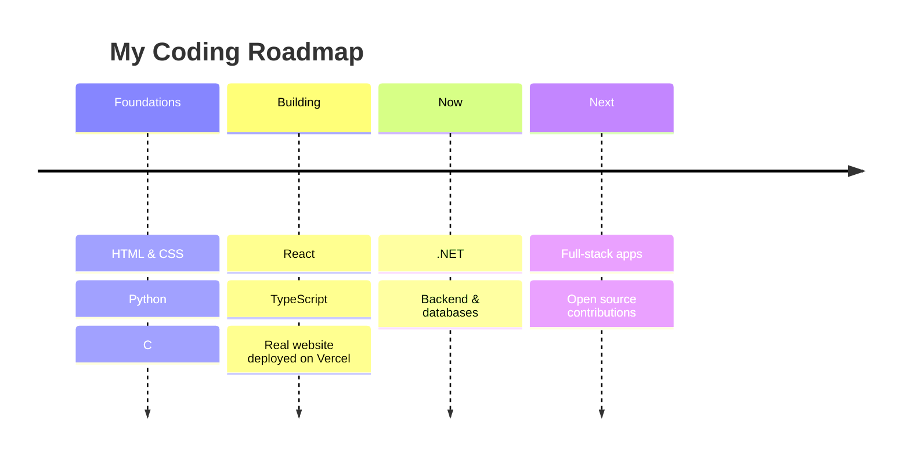

<!-- Replace every DakshLearner below with your GitHub username if it's different -->


<div align="center">

[](https://git.io/typing-svg)


[](https://guruji-shrawan.vercel.app/)

</div>

---

## 👨‍💻 About Me

```js
const nitin = {
  name: "Nitin Mishra",
  role: "Aspiring Coder & Designer",
  location: "[Your City, Country]",
  education: "[Your College / Course]",
  codes: ["HTML", "CSS", "Python", "C", "React", "TypeScript", ".NET"],
  designs: ["Adobe Tools", "UI / Graphic Design"],
  currentlyBuilding: "Full-stack projects that people actually use",
  funFact: "I can code the UI and design it too 🎨",
  lookingFor: "Internships & collaborations 🤝",
};
```

---

## ⚡ Tech Arsenal

<div align="center">


<br/>

<br/><br/>


</div>

---

## 🚀 Featured Projects

<table>
<tr>
<td width="50%" valign="top">

### 🌐 Guruji Shrawan Platform
A full website for a spiritual teacher & author: articles, books, video series, sign-in/sign-up, donations, English + Hindi, SEO-ready.

`React / Next.js` `TypeScript` `CSS` `Vercel`

[](https://guruji-shrawan.vercel.app/)

</td>
<td width="50%" valign="top">

### 🏫 School Management System
Python CLI app with Student, Teacher & Attendance modules, CSV storage, class-wise attendance marking and low-attendance warnings.

`Python` `CSV` `File Handling` `CLI`

[](https://github.com/DakshLearner/school-management_26-27)

</td>
</tr>
</table>

---

## 📚 Learning Journey



---

## 📊 GitHub Stats

<div align="center">


</div>

---

## 🐍 Contribution Snake

<div align="center">
<picture>
  <source media="(prefers-color-scheme: dark)" srcset="https://raw.githubusercontent.com/DakshLearner/DakshLearner/output/github-snake-dark.svg" />
  <source media="(prefers-color-scheme: light)" srcset="https://raw.githubusercontent.com/DakshLearner/DakshLearner/output/github-snake.svg" />
  
</picture>
</div>

---

## 🤝 Let's Connect

<div align="center">

[](https://linkedin.com/in/your-handle)
[](mailto:your.email@example.com)
[](https://instagram.com/your-handle)

*⭐ If you like what you see, drop a star on my repos!*

</div>


