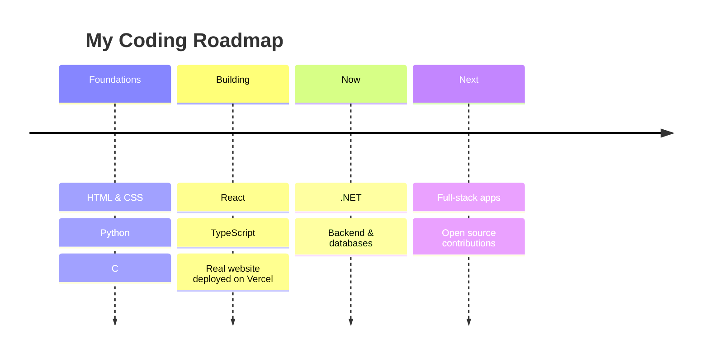

<div align="center">
</div>
## 👨‍💻 About Me
```js
const nitin = {
  name: "Nitin Mishra",
  role: "Aspiring Coder & Designer",
  location: "India 🇮🇳",
  education: "Class 11 (PCM + AI)",
  codes: ["HTML", "CSS", "Python", "React", "TypeScript", ".NET"],
  designs: ["Adobe Tools", "UI / Graphic Design"],
  currentlyBuilding: "Full-stack projects that people actually use",
  funFact: "I can code the UI and design it too 🎨",
  lookingFor: "Internships & collaborations 🤝",
};

```
## ⚡ Tech Arsenal
<div align="center">


</div>
## 🚀 Featured Projects
<table>
<tr>
<td width="50%" valign="top">
### 🌐 Guruji Shrawan Platform
A full website for a spiritual teacher & author: articles, books, video series, sign-in/sign-up, donations, English + Hindi, SEO-ready.
React / Next.js TypeScript CSS Vercel
</td>
<td width="50%" valign="top">
### 🏫 School Management System
Python CLI app with Student, Teacher & Attendance modules, CSV storage, class-wise attendance marking and low-attendance warnings.
Python CSV File Handling CLI
</td>
</tr>
</table>
## 📚 Learning Journey

## 📊 GitHub Stats
<div align="center">


</div>
## 🐍 Contribution Snake
<div align="center">
<picture>
<source media="(prefers-color-scheme: dark)" srcset="https://raw.githubusercontent.com/heyitskushagra/heyitskushagra/output/github-snake-dark.svg" />
<source media="(prefers-color-scheme: light)" srcset="https://raw.githubusercontent.com/heyitskushagra/heyitskushagra/output/github-snake.svg" />

</picture>
</div>
## 🤝 Let's Connect
<div align="center">
*⭐ If you like what you see, drop a star on my repos!*
</div>

